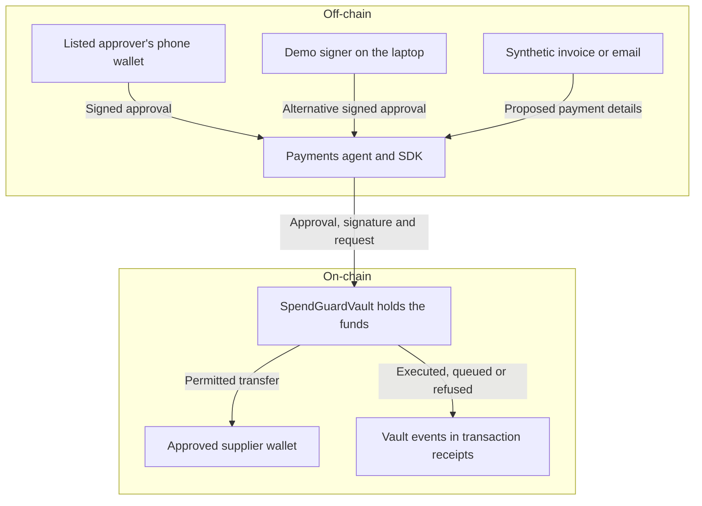
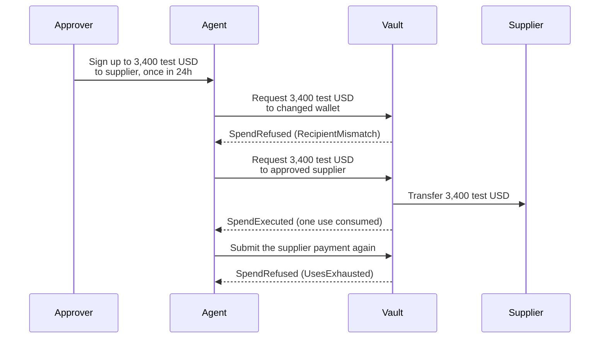

# How a supplier payment works

## Architecture

The phone wallet signs an EIP-712 approval for a particular chain and vault. It covers the agent, token, recipient, amount limits, number of uses and expiry. Only the signature returns from the phone. On the local chain the stage also offers a labelled server-side demo signer; on testnet the stage turns it off, so only a person approves. Either way, the vault checks the request against the signature and its own policy.

The registered agent submits with its own key. It can use an offline mock or a configured model to propose payments. An optional CoinMarketCap price check can hold a request before submission. The vault makes its decision on-chain. The owner sets its limits and the guardian can freeze spending. A queued payment requires a separate release after the delay.

## User journey

The stage defaults to a local chain (31337). Choose **Use this request**, review the supplier and limit, then choose **Approve on my phone** or **Demo signer on this laptop**. The recorded run below used a scripted approver on BNB Smart Chain testnet (97).

To check the result, open the three transactions in the proof file and read the vault events. All three requests produced transaction receipts. Only the middle request moved tokens. The supplier gained 3,400 test USD, the vault balance fell by 3,400 test USD and the changed wallet received zero. [Testnet proof with explorer links and balances](../evidence/wp2-core-proof-2026-11-25T07-48-29-448Z.json)
